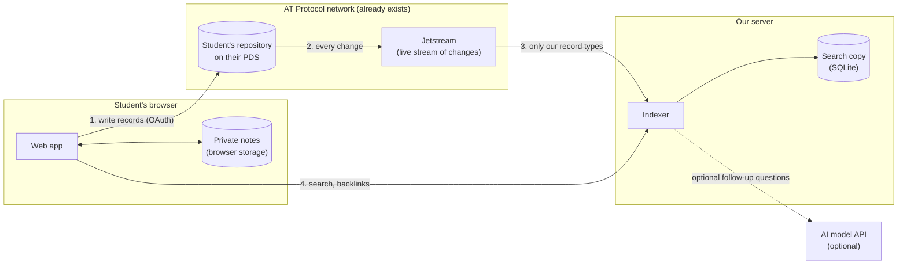
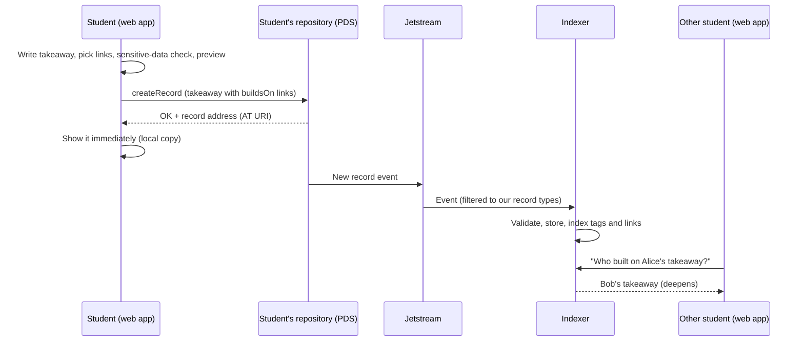
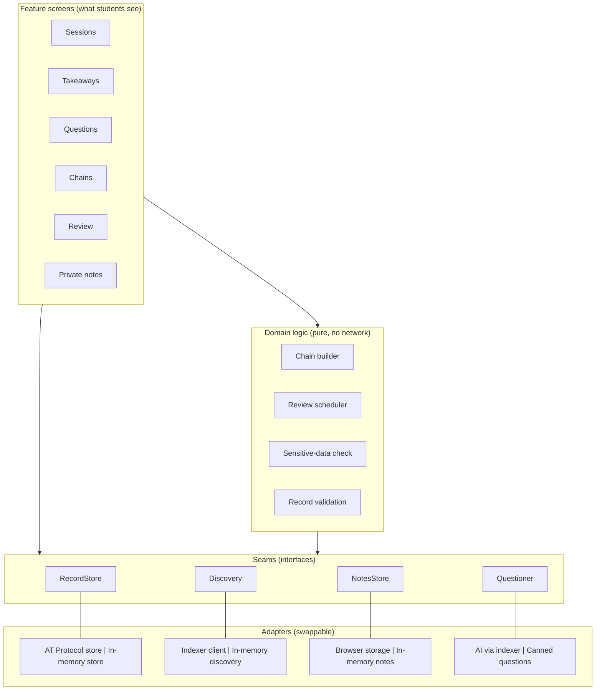
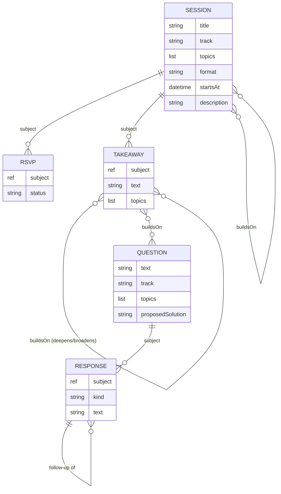
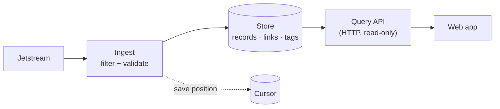

# Architecture Design: Learning Chains

Draft v0.1 · 2026-11-06 · Builds on [PROPOSAL.md](PROPOSAL.md) and [DESIGN_PRINCIPLES.md](DESIGN_PRINCIPLES.md)

This document explains **how the app is put together and why**. Each section ends with the reasoning behind its choices. Section 9 lists the diagrams to carry into the slides, and section 10 shows how this design becomes the demo app.

---

## 1. The big picture in one paragraph

Learning Chains has **two parts we build**: a **web app** that runs in the student's browser, and a small **indexer** server. Everything else (accounts, storage of students' data, the live stream of changes) **already exists** on the AT Protocol network. When a student publishes something, the web app saves it **directly into the student's own repository**. When a student wants to *find* things (sessions on a topic, who built on their work), the web app asks the **indexer**, which has been listening to the network and keeping a searchable copy of our app's records.



**Why this shape**

- **Writes go straight to the student's repository, not through our server.** That is what "students own their data" means in practice: our server never holds a student's login or their records. If our server disappears, every student's history is still in their own repository.
- **Reads go through the indexer because the protocol has no "search everyone" feature.** Each repository only knows its own records. To answer "all sessions tagged `transformers`" or "who built on this takeaway?", someone has to collect records from everyone. That's the indexer's one job.
- **The indexer is a copy, not the source of truth.** If its database is lost, it can be rebuilt by replaying the stream or re-reading repositories. This keeps the server simple and low-risk: there's nothing on it that can't be recovered.

---

## 2. Write path and read path

The app has two separate flows, and keeping them apart is the most important structural decision.



| | Write path | Read path |
|---|---|---|
| **Goes to** | Student's own repository | Our indexer |
| **Needs login?** | Yes (OAuth, as the student) | No, everything indexed is public anyway |
| **Speed** | Immediate for the author | A few seconds behind (the stream has to deliver it) |

**Why separate them**

- **Each side can change without touching the other** (decoupling). We could replace our indexer with a different one, or add a second indexer, without changing how records are written.
- **The delay is honest and manageable.** Other students see a new record a few seconds after it's written. The author sees their own record instantly because the web app shows its local copy. For study sessions, a few seconds don't matter.

---

## 3. What we build, split into modules



The web app has **three layers**, and each layer only talks downward:

1. **Feature screens.** One per service from the proposal. They show data and collect input. They contain no business rules.
2. **Domain logic.** The rules of the app: how a chain is assembled, when a takeaway is due for review, what counts as sensitive data, whether a record is valid. This code is **pure**. It never touches the network or storage, so it's easy to test and to reason about.
3. **Seams and adapters.** Four interfaces describe *what* the app needs from the outside world. Adapters provide *how*. Each seam has exactly two adapters: a **real** one and an **in-memory** one.

**Why this split**

- **Separation of concerns.** Screens don't know rules; rules don't know the network. A change to how chains are drawn never risks breaking how chains are computed.
- **Every seam is a real seam** (principle 6: two adapters, not one). The in-memory adapters aren't test-only extras: **they're what the demo app runs on** (section 10).
- **The domain layer is where the project's ideas live.** "Deepens vs. broadens," "students confirm links," "review after 7 and 30 days": all of it sits in one testable place instead of spread across screens.

---

## 4. The four seams

These are the contracts. Everything else in the web app depends on these, never on AT Protocol or the indexer directly.

```ts
// Every operation returns the same result shape (principle 9: consistent errors).
type Result<T> = { ok: true; value: T } | { ok: false; error: AppError };
type AppError = { kind: "notFound" | "invalid" | "unauthorized" | "network" | "rateLimited"; message: string };

// 1. The signed-in student's own repository: create, edit, delete their records.
interface RecordStore {
  create<K extends RecordKind>(kind: K, value: RecordValue<K>): Promise<Result<RecordRef>>;
  update<K extends RecordKind>(ref: RecordRef, value: RecordValue<K>): Promise<Result<RecordRef>>;
  remove(ref: RecordRef): Promise<Result<void>>;
  get(uri: AtUri): Promise<Result<StoredRecord>>; // any user's public record
}

// 2. Finding things across all students (backed by the indexer).
interface Discovery {
  listSessions(filter: { track?: Track; tags?: string[]; from?: Date }): Promise<Result<Session[]>>;
  listQuestions(filter: { track?: Track; tags?: string[] }): Promise<Result<Question[]>>;
  getResponses(questionUri: AtUri): Promise<Result<Response[]>>;
  getBacklinks(uri: AtUri): Promise<Result<Link[]>>;           // "built on by ↓"
  suggestLinks(draft: { track: Track; tags: string[] }): Promise<Result<StoredRecord[]>>; // tag overlap
}

// 3. Private notes: never leave the browser.
interface NotesStore {
  list(): Promise<Result<Note[]>>;
  save(note: Note): Promise<Result<void>>;
  remove(id: string): Promise<Result<void>>;
}

// 4. Optional AI follow-up questions (behind a flag, off by default).
interface Questioner {
  followUps(takeawayText: string): Promise<Result<string[]>>; // questions only, never answers
}
```

**Why these four, and why this small**

- **Each one hides a lot** (deep modules). `RecordStore.create` hides OAuth tokens, the AT Protocol client, retries, and record encoding. `Discovery.getBacklinks` hides HTTP, paging, and whether the answer comes from our indexer or from Constellation.
- **They follow the natural split of the data**: what I own (RecordStore), what everyone published (Discovery), what's private to me (NotesStore), and the optional AI (Questioner).
- **`suggestLinks` only suggests.** It returns candidates sharing tags; the student decides. The rule "students confirm every link" is enforced by the screens and domain logic, not left to the indexer.

---

## 5. Data model

Every record lives in a student's repository and has a permanent address, an **AT URI**: `at://<student's DID>/<record type>/<key>`. Links between records are just AT URIs stored inside a record.



| Record | Key fields | Notes |
|---|---|---|
| `session` | title, track (`concepts` / `practice`), topics, format, startsAt, description, buildsOn | **No meeting link or location field, by design** (privacy §8 of proposal) |
| `rsvp` | subject (a session), status (`going` / `interested`) | Public; reveals attendance (known limitation) |
| `takeaway` | subject (a session), text, topics, buildsOn | The main unit of a chain |
| `question` | text, track, topics, proposedSolution (optional) | Conceptual, not homework |
| `response` | subject (a question or another response), kind (`solution` / `followUp`), text | Forms a thread |
| `buildsOn` entry | target (AT URI + version hash), relation (`deepens` / `broadens`) | Always confirmed by the student |

**Why this model**

- **Links live on the newer record** (Bob's takeaway says "I build on Alice's"). That's the only option: Bob can't write into Alice's repository. It's also how Bluesky replies work, so it fits the protocol rather than fighting it.
- **Backward links ("built on by") are computed by the indexer.** Nobody has to update an old record when a new one links to it. Old records never change, which keeps history reliable.
- **A link points to a specific version** (AT URI + content hash). If Alice later edits her takeaway, Bob's link still shows what he actually built on. That's an audit-friendly default: history isn't silently rewritten.
- **Schemas only ever get new optional fields after launch** (principle 2). Records already in students' repositories must stay valid forever. **This is the one decision that's hard to reverse**, so the data model gets reviewed before the first real record is published.

---

## 6. The indexer



Three steps, one job each:

1. **Ingest.** Subscribes to Jetstream **only for our record types**, so we never process the rest of Bluesky. Every incoming record is **validated once here**; anything malformed is dropped and logged. Creates, edits, and **deletes** are all applied, so deleted records disappear from our app too.
2. **Store.** SQLite with three tables: `records` (every valid record, by AT URI), `links` (one row per buildsOn entry, for fast backlinks), and `tags` (for filtering by track and topic).
3. **Query API.** Read-only HTTP endpoints that match the `Discovery` seam: list sessions, list questions, get responses, get backlinks, suggest links.

**Why it's built this way**

- **Validate at the edge** (principle 3). Records on the network can be written by anyone, including broken or malicious clients. Checking once on the way in means the rest of the system can trust what it reads.
- **Saving is idempotent, keyed by the record's address and version.** If the stream delivers the same event twice, or we replay from an old position after a crash, nothing is duplicated. The saved cursor lets the indexer resume where it stopped.
- **Read-only API.** The indexer never writes to students' repositories and never stores logins. Its attack surface is small, and losing it costs nothing that can't be rebuilt.
- **Our own index rather than Constellation, for now.** We need track and tag filtering anyway, so we need a store either way. Backlinks come almost free once records are stored. Constellation stays an option behind the `Discovery` seam.

---

## 7. Key flows

### 7.1 Publish a takeaway that builds on someone else's

1. Student writes the takeaway after a session.
2. The web app asks `Discovery.suggestLinks` for earlier records with the same tags and shows them.
3. Student picks the ones it really builds on and marks each as **deepens** or **broadens**.
4. **Sensitive-data check** (domain logic, in the browser) warns about emails, IDs, API keys.
5. **Preview** shows exactly what becomes public.
6. `RecordStore.create` writes it to the student's repository; the web app shows it immediately.
7. Seconds later, the indexer has it, and the other student sees "built on by ↓" on their own takeaway.

### 7.2 View a chain

`getChain(uri)` lives in the domain layer and combines two directions:
- **Upward ("builds on ↑")**: read the record's own `buildsOn` links, then those records' links, and so on.
- **Downward ("built on by ↓")**: ask `Discovery.getBacklinks`.

The chain builder returns a small graph (nodes + labeled edges) that the Chains screen draws. Depth is capped (e.g. 5 levels each way) so a long chain can't make the page hang.

### 7.3 Review reminders

The review scheduler is pure: given the student's takeaways and today's date, it returns which ones are due (e.g. 7 and 30 days after creation). It sends nothing by itself. The Review screen shows the list.

### 7.4 AI follow-up questions (optional)

The web app sends **only a public takeaway's text** to the indexer's AI endpoint. The indexer calls the model with instructions to ask questions and never answer, and returns 2–3 questions. **The API key stays on the server**; it never reaches the browser. Off by default.

---

## 8. Decisions and alternatives

| Decision | Alternatives considered | Why we chose it |
|---|---|---|
| Browser writes directly to the student's repository | Route writes through our server | Students own their data; our server never holds logins or records |
| Separate indexer for reads | Query each student's repository live | No protocol-level search; querying every repository per page load is slow and fragile |
| Indexer is a rebuildable copy | Indexer as the main database | Nothing irreplaceable on our server; lower risk |
| Jetstream | Raw firehose | Jetstream sends JSON and filters by record type, much simpler. The firehose remains a fallback |
| SQLite | Postgres | Enough for pilot scale, zero setup. Switch only if needed |
| Our own backlinks | Constellation | We need a store for tag filtering anyway; Constellation stays swappable |
| Links point to a specific version | Links point to "latest" | History stays truthful when records are edited |
| Students confirm every link | Automatic links from tags | Keeps chains meaningful; follows principle 3 (human thinking) |
| Private notes in browser storage | Our server / encrypted public records | We don't hold sensitive data; no risk of a key leaking public data |
| AI called from the server | AI called from the browser | Keeps the API key secret |
| One `Result` type for all errors | Mix of exceptions and nulls | Callers handle failure one way everywhere |
| TypeScript everywhere (React + Vite web app, Node indexer) | Different languages per part | Shared record types and validation code between web app and indexer |

---

## 9. Diagrams for the slides

Three diagrams carry the design story. Each already exists above as a Mermaid diagram and can be redrawn on slides:

| Slide | Diagram | Message |
|---|---|---|
| **System overview** | §1 flowchart | "We build two small parts; the network already provides accounts, storage, and the event stream." |
| **Write path vs. read path** | §2 sequence | "Students write to their own repository; we only keep a searchable copy." |
| **Module and seam map** | §3 layers | "Screens → rules → seams → swappable adapters. The demo runs on in-memory adapters." |

Optional fourth slide: the data model (§5), if the audience is technical.

---

## 10. From design to demo app

The demo is **the real web app with in-memory adapters** instead of the real network:

| Part | Demo | Final app |
|---|---|---|
| Feature screens | Same | Same |
| Domain logic | Same | Same |
| `RecordStore` | In-memory, pre-loaded with sample students (Alice, Bob, Carol) | AT Protocol adapter with OAuth |
| `Discovery` | In-memory, computed from the same sample data | Indexer client |
| `NotesStore` | Browser storage | Browser storage |
| `Questioner` | Canned example questions | AI via indexer (optional) |
| Indexer | Not needed | Required |

**Why this is the right demo**

- **Nothing is throwaway.** The screens and domain logic built for the demo are the final ones. Only adapters change later.
- **It shows the full core loop without any network setup:** browse sessions by track and tag → open a session → publish a takeaway → confirm suggested links → view the chain → see review reminders.
- **It's honest about what's done.** The demo shows the product experience. Real AT Protocol integration (OAuth, writing to repositories, the indexer) is the next build step. Present it that way, not as finished.

**Demo scope (first iteration):**
1. Session list with track and tag filters
2. Session detail with its takeaways
3. Publish a takeaway with suggested links and deepens/broadens choice, plus sensitive-data warning and preview
4. Chain view (builds on ↑ / built on by ↓)
5. Questions with responses
6. Review list
7. Private notes

Planned code layout:

```
app/
  src/
    features/      sessions, takeaways, questions, chains, review, notes (screens)
    domain/        chainBuilder, reviewScheduler, sensitiveCheck, validation (pure)
    ports/         RecordStore, Discovery, NotesStore, Questioner (interfaces)
    adapters/
      memory/      in-memory adapters + sample data (demo, tests)
      atproto/     real RecordStore (later)
      indexer/     real Discovery client (later)
  tests/           domain tests + seam contract tests run against every adapter
indexer/           (later) ingest, store, query API
```

One testing idea matters here: **the same contract tests run against both adapters of each seam.** If the in-memory store and the real AT Protocol store pass the same tests, swapping them later is safe.

---

## 11. Open design questions

1. **Hosting for the indexer** (school server, free tier). Needed before the real build, not for the demo.
2. **Lexicon namespace domain.** Needed before any real record is published.
3. **Review timing.** Are 7 and 30 days the right reminders? Easy to change; it's one pure function.
4. **Chain depth cap.** 5 levels is a guess; revisit with real data.
5. **Report button.** The proposal includes reporting content (e.g. possible graded work) so it's hidden from our index. Simplest design: a `report` endpoint on the indexer plus a hidden flag on the record row. Not in the demo; decide before the pilot.
6. **Sessions on other tools.** Hosts share meeting links by DM for now. Revisit when AT Protocol private data (Spaces) is stable.
