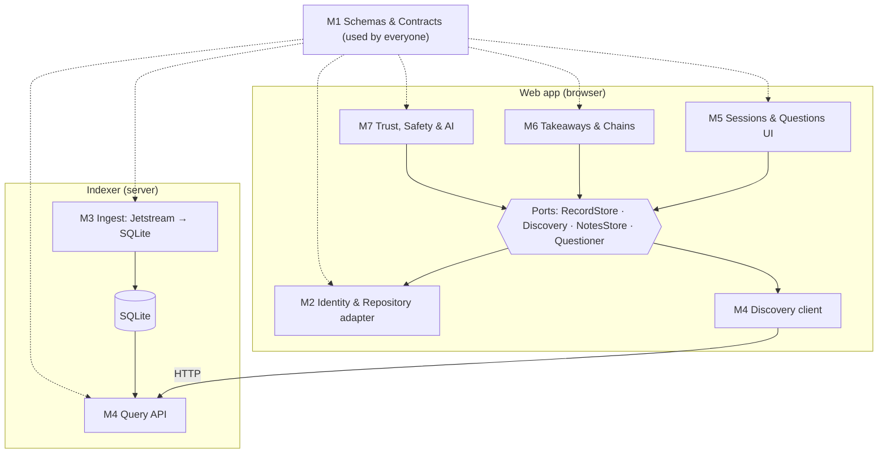

# Module Design: Learning Chains, for a Team of 7

Draft v0.1 · 2026-11-06 · Builds on [ARCHITECTURE.md](ARCHITECTURE.md) and [DESIGN_PRINCIPLES.md](DESIGN_PRINCIPLES.md). AT Protocol specifics are in [ATPROTO_TOOLS.md](ATPROTO_TOOLS.md).

This document splits the app into **seven modules, one owner each**. For every module it states what goes in, what comes out, what it must do, and how it's tested, so each person can work independently and the pieces still fit.

---

## 1. How the split works

The architecture already has the right seams. We cut along them:



**Three kinds of modules:**

| Kind | Modules | What they share |
|---|---|---|
| **Foundation** | M1 Schemas & Contracts | Record types, validation, test fixtures, contract tests. Everyone depends on it |
| **Platform** (talks to AT Protocol) | M2 Identity & Repository, M3 Indexer Ingest, M4 Indexer Query & Discovery | Implement the ports and the server against real AT Protocol tools |
| **Features** (what students see) | M5 Sessions & Questions, M6 Takeaways & Chains, M7 Trust, Safety & AI | Use only the ports, so they run on in-memory adapters from day one |

**Why this split works for 7 people**

- **Nobody waits on anybody.** Feature owners (M5–M7) build against the in-memory adapters that already exist. Platform owners (M2–M4) build real adapters against the same contract tests. Integration is a swap, not a merge of half-finished parts.
- **Every boundary is a written contract:** a TypeScript interface, a Lexicon schema, an HTTP API, or a database schema. Contracts change only by agreement (§4).
- **Each module is a folder with one owner** (enforced by a `CODEOWNERS` file), so review responsibility is clear.

---

## 2. The seven modules

Each card: **owns** (folders) · **input** · **output** · **must do** · **AT Protocol tools** · **depends on** · **done when** · **starts with**.

### M1 · Schemas & Contracts (foundation)

| | |
|---|---|
| **Owns** | `packages/lexicons/` (Lexicon JSON, generated types, validation), `packages/contracts/` (contract tests, sample data), CI config |
| **Input** | Data model decisions (ARCHITECTURE §5); requests from other owners for new fields |
| **Output** | Lexicon JSON files for the 5 record types; generated TypeScript types; `validateRecord(kind, value) → Result`; sample data; contract test suites for `RecordStore` and `Discovery` |
| **Must do** | Keep records valid forever (only add optional fields after launch); run schema review before first publish; keep CI green |
| **AT Protocol tools** | Lexicon JSON with `com.atproto.repo.strongRef` links; **`@atproto/lex`** (`lex build`) to generate types and validators shared by browser and indexer; **`goat lex lint / publish`** + `_lexicon` DNS record; **`@atproto/dev-env`** for contract tests (ATPROTO_TOOLS §1, §9) |
| **Depends on** | Nothing |
| **Done when** | Every record type has a Lexicon, generated types, and validation tests; contract suites run against every adapter in CI |
| **Starts with** | The existing `domain/types.ts` and `validation.ts`, converted into Lexicon JSON |

### M2 · Identity & Repository (platform, browser)

| | |
|---|---|
| **Owns** | `packages/app/src/adapters/atproto/` |
| **Input** | A student's handle (e.g. `alice.bsky.social`); record values from feature screens; record addresses (AT URIs) to read |
| **Output** | A signed-in session (`me: DID`); the real `RecordStore` (create / update / remove / get); profiles for display |
| **Must do** | Sign in with Bluesky OAuth, request only the permissions we need, refresh sessions, sign out; write records to the student's own repository; read any public record; map protocol errors into our `Result` shape |
| **AT Protocol tools** | **`@atproto/oauth-client-browser`** with scope `atproto repo:<ns>.session repo:<ns>.rsvp repo:<ns>.takeaway repo:<ns>.question repo:<ns>.response`; **`createRecord`** (tid keys), **`putRecord`** (RSVPs, edits with `swapRecord`), **`deleteRecord`**, **`getRecord`**; `app.bsky.actor.getProfiles` on `public.api.bsky.app` (ATPROTO_TOOLS §2–§4) |
| **Depends on** | M1 (types, validation) |
| **Done when** | Passes the `RecordStore` contract suite against a local test network; sign-in works end to end |
| **Starts with** | The `RecordStore` interface and its contract tests (already written) |

### M3 · Indexer Ingest (platform, server)

| | |
|---|---|
| **Owns** | `packages/indexer/src/ingest/`, `packages/indexer/src/db/` (the database schema) |
| **Input** | Jetstream events for our five collections only; backfill from repositories when starting fresh |
| **Output** | Rows in SQLite: `records`, `links` (one per buildsOn entry), `tags`, `hidden` (reported records); a saved stream position (cursor) |
| **Must do** | Validate every incoming record once (records come from strangers); apply creates, updates, and **deletes**; be safe to replay (same event twice changes nothing); resume from the saved cursor after a crash; log and drop malformed records |
| **AT Protocol tools** | **Jetstream v2** via **`@bsky/jetstream`** `LexIndexer` with `collections=<ns>.*`; backfill with **`com.atproto.sync.listReposByCollection`** then `listRecords`; `@atproto/identity` for author lookup; **Tap** as the fallback (ATPROTO_TOOLS §4, §5) |
| **Depends on** | M1 (validation) |
| **Done when** | Replaying a recorded event file twice yields identical tables; deletes remove rows; a record appears in the DB within 10 s of being written on a test network (measured) |
| **Starts with** | A recorded file of Jetstream events for our collections, so work doesn't need a live network |

### M4 · Indexer Query & Discovery (platform, server + browser)

| | |
|---|---|
| **Owns** | `packages/indexer/src/api/`, `packages/app/src/adapters/indexer/` |
| **Input** | The SQLite tables written by M3 (read-only); HTTP requests from the web app |
| **Output** | A read-only HTTP API (§3) and the browser-side `Discovery` adapter that calls it |
| **Must do** | Serve every `Discovery` method with paging; compute backlinks and tag-based link suggestions; hide reported records; never write to repositories or store logins |
| **AT Protocol tools** | AT URIs as identifiers; **`app.bsky.actor.getProfiles`** (25 per call, cached) for author names; **Constellation** `blue.microcosm.links.getBacklinks` as a cross-check for our backlinks (ATPROTO_TOOLS §4, §6) |
| **Depends on** | M1; M3's database schema (read-only contract) |
| **Done when** | The browser `Discovery` adapter passes the same contract suite as the in-memory one; p95 response under 200 ms on pilot-sized data (measured) |
| **Starts with** | The `Discovery` interface, its contract tests, and a SQLite file seeded from the sample data |

### M5 · Sessions & Questions (feature, browser)

| | |
|---|---|
| **Owns** | `packages/app/src/features/sessions/`, `packages/app/src/features/questions/` |
| **Input** | `RecordStore`, `Discovery` (ports only) |
| **Output** | Screens: session list with track and topic filters, session detail, host-a-session form, RSVP; question list, ask form, threaded solutions and follow-ups |
| **Must do** | Never put meeting links or locations in public records; route every publish through M7's publish panel; show loading, empty, and error states |
| **AT Protocol tools** | None directly (all through ports) |
| **Depends on** | Ports; M7's publish panel component |
| **Done when** | Component tests for host, RSVP, ask, and reply flows; works unchanged when real adapters are swapped in |
| **Starts with** | The existing demo screens in `features/sessions.tsx` and `features/questions.tsx` |

### M6 · Takeaways & Learning Chains (feature, browser)

| | |
|---|---|
| **Owns** | `packages/app/src/features/takeaways/`, `features/chains/`, `features/review/`, `domain/chainBuilder`, `domain/reviewScheduler` |
| **Input** | `RecordStore`, `Discovery` |
| **Output** | Takeaway composer with link suggestions and deepens/broadens choice; chain view (builds on ↑ / built on by ↓); review list (7 and 30 days) |
| **Must do** | Links are always confirmed by the student, never automatic; chain building is cycle-safe and depth-capped; deleted targets show as missing instead of breaking |
| **AT Protocol tools** | None directly. Uses strongRefs (address + version) produced by M2 |
| **Depends on** | Ports; M7's publish panel |
| **Done when** | Unit tests for chain builder and review timing; component test for the publish flow; chain view renders a 3-student chain from contract fixtures |
| **Starts with** | The existing composer, chain builder, chain view, and review screen |

### M7 · Trust, Safety & AI (feature + small server part)

| | |
|---|---|
| **Owns** | `packages/app/src/features/safety/` (publish panel, sensitive-data check, private notes, report button), `packages/indexer/src/ai/`, `packages/indexer/src/reports/` |
| **Input** | Text about to be published; report requests; public takeaway text for AI questions |
| **Output** | `PublishPanel` component used by M5 and M6; `checkSensitive(text) → findings`; private notes (`NotesStore`); report endpoint; AI follow-up endpoint behind a flag (off by default) |
| **Must do** | Preview and public notice on every publish; warn on emails, IDs, API keys, meeting links; private notes never leave the browser; AI only asks questions, never answers; the AI key stays on the server |
| **AT Protocol tools** | MVP: none (in-app reports). Stretch: **Ozone** labeler + `com.atproto.moderation.createReport` + `subscribeLabels`. Future: **Spaces** personal space for notes (ATPROTO_TOOLS §7, §8) |
| **Depends on** | M1; M4's server (hosts the AI and report endpoints) |
| **Done when** | Sensitive check measured on a labeled test set (precision and recall reported); AI questions measured for answer leakage on a fixed test set; reported records disappear from search |
| **Starts with** | The existing `sensitiveCheck`, `PublishPanel`, notes screen, and canned questioner |

---

## 3. The contracts between modules

Everything crossing a module boundary is one of these five contracts. Changing one needs agreement from both sides (§4).

| Contract | Between | Form | Defined in |
|---|---|---|---|
| **Record schemas** | M1 → everyone | Lexicon JSON + generated TypeScript types | `packages/lexicons/` |
| **Ports** | M5, M6, M7 → M2, M4 | TypeScript interfaces: `RecordStore`, `Discovery`, `NotesStore`, `Questioner` | `packages/app/src/ports/` (already written) |
| **Contract tests** | M1 → M2, M4 | Test suites every adapter must pass | `packages/contracts/` (already written) |
| **Database schema** | M3 → M4 | SQLite tables; M3 writes, M4 only reads | `packages/indexer/src/db/schema.sql` |
| **Query API** | M4 server → M4 client, M7 | HTTP + JSON, below | `packages/indexer/src/api/openapi.yaml` |

### 3.1 Query API (draft)

Read-only, public data only. Every list endpoint takes `limit` (default 25, max 100) and returns `{ items, cursor? }`.

| Method & path | Matches | Returns |
|---|---|---|
| `GET /v1/sessions?track=&tag=&cursor=` | `Discovery.listSessions` | Sessions, soonest first |
| `GET /v1/questions?track=&tag=&cursor=` | `Discovery.listQuestions` | Questions, newest first |
| `GET /v1/takeaways?session=<at-uri>` | `Discovery.listTakeaways` | Takeaways of one session |
| `GET /v1/responses?subject=<at-uri>` | `Discovery.getResponses` | Replies to a question or response |
| `GET /v1/authors/<did>/records` | `Discovery.listByAuthor` | One author's records, newest first |
| `GET /v1/backlinks?uri=<at-uri>` | `Discovery.getBacklinks` | `{ from, relation }[]` |
| `GET /v1/suggestions?tags=a,b&exclude=<at-uri>` | `Discovery.suggestLinks` | Up to 5 records sharing tags |
| `POST /v1/reports` `{ uri, reason }` | M7 report button | `202 Accepted`; record hidden after review |
| `POST /v1/ai/follow-ups` `{ uri }` | `Questioner.followUps` (flag) | `{ questions: string[] }`. The server reads the public record itself, so clients can't send private text |

Errors use one shape everywhere: `{ error: "notFound" | "invalid" | "rateLimited" | ..., message }`, matching the app's `Result` type.

**Change from the demo:** the demo's `Questioner.followUps(takeawayText)` takes text. The real port should take a record address (`followUps(uri)`), so the server reads the published record itself and can't be handed private notes. M7 makes this change, contract first.

### 3.2 Database schema (draft, owned by M3)

| Table | Key columns | Notes |
|---|---|---|
| `records` | `uri` (PK), `cid`, `author_did`, `kind`, `created_at`, `json`, `indexed_at` | One row per live record; deleted on delete events |
| `links` | `from_uri`, `to_uri`, `to_cid`, `relation` | One row per buildsOn entry, for backlinks |
| `tags` | `uri`, `tag` | For track and topic filtering |
| `hidden` | `uri`, `reason`, `reported_at` | Reported records excluded from every query |
| `cursor` | `id`, `time_us` | Last processed stream position |

---

## 4. Working rules for the team

1. **Contract first.** Change the interface, schema, or API *before* the code, in its own small pull request, reviewed by both sides.
2. **Add, don't modify.** New optional fields and new endpoints are fine. Renames and removals need everyone's agreement, and record schemas can't change at all after launch.
3. **Code owners review.** `CODEOWNERS` maps each folder to its module owner, and every pull request needs that owner's approval.
4. **Contract tests are the integration test.** A real adapter that passes the same contract suite as the in-memory one can be swapped in without touching feature code.
5. **Main stays green.** CI (type-check, tests, build, secret scan) must pass before merging.
6. **Weekly integration day.** Everyone merges, the demo runs on the latest code, and blockers are raised.

---

## 5. Build order and timeline

Because features run on in-memory adapters, all seven people start in week 1.

| Phase | M1 Schemas | M2 Identity & Repo | M3 Ingest | M4 Query | M5 Sessions & Q | M6 Takeaways & Chains | M7 Safety & AI |
|---|---|---|---|---|---|---|---|
| **1. Contracts** | Lexicons, generated types | OAuth prototype on test network | Record sample Jetstream events | API spec, seeded SQLite | Screens on in-memory | Screens on in-memory | Publish panel shared |
| **2. Build** | Contract suites in CI | `RecordStore` passes contracts | Ingest + replay safety | API + `Discovery` client pass contracts | Error/empty states | Chain view polish | Report flow, test sets |
| **3. Integrate** | Schema review (one-way door) | Swap real store in | Run against live Jetstream | Swap real discovery in | Test on real adapters | Test on real adapters | AI endpoint behind flag |
| **4. Pilot** | Support | Support | Monitor lag | Monitor speed | Fix from feedback | Fix from feedback | Measure warnings + AI leakage |

**Critical path:** M1's schemas → M2's sign-in and M3's ingest → swapping in real adapters. Phase 3 can't start until the schema review is done, because records published after that can never be changed.

**Before phase 1:** the demand validation in the proposal (interviews and the 2-week test). If it says "stop" or "pivot," this plan changes.

---

## 6. Repository layout (target)

The demo is one app today. The team version becomes a small monorepo (npm workspaces):

```
packages/
  lexicons/     M1  Lexicon JSON, generated types, validation
  contracts/    M1  contract test suites, sample data
  app/          web app
    src/ports/              shared interfaces (change by agreement)
    src/adapters/memory/    M1  in-memory adapters (demo + tests)
    src/adapters/atproto/   M2
    src/adapters/indexer/   M4
    src/features/sessions/  M5
    src/features/questions/ M5
    src/features/takeaways/ M6
    src/features/chains/    M6
    src/features/review/    M6
    src/features/safety/    M7
  indexer/      server
    src/ingest/  M3
    src/db/      M3
    src/api/     M4
    src/reports/ M7
    src/ai/      M7
.github/CODEOWNERS
```

**Moving from today's layout** is a mechanical reshuffle of existing files, best done in one pull request before the team starts so nobody works on moving targets.
